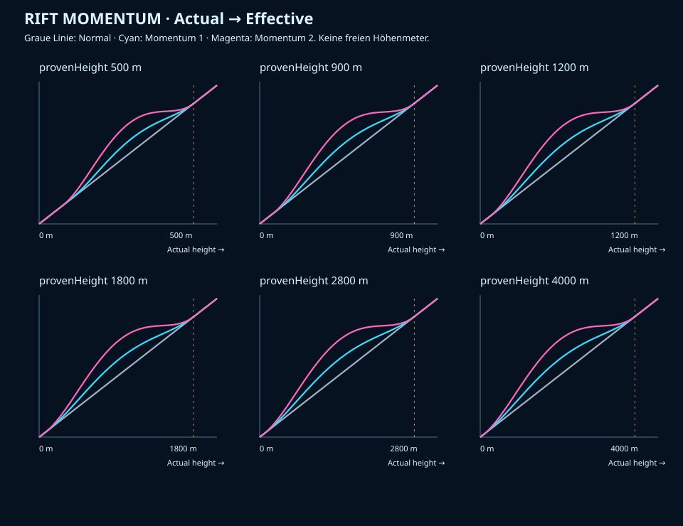

# M8.1 — RIFT MOMENTUM

Stand: 28.10.2026. Ausgang: main `95ea46c` (Infinity First).

## Problem und vorhandene Systeme

M8 startete jeden Run mit derselben gestreckten Auswahlkurve. Selbst wiederholt
erfolgreiche Spieler mussten den bekannten Einstieg vollständig wiederholen.
Der vorhandene Save enthielt Rekord, Versuche, letzte Höhe und Todesfälle, jedoch
keine verlässliche Historie abgeschlossener Runs. Ein Rekord allein ist kein
Nachweis wiederholter Kompetenz; `lastHeight` kann auch aus einem unterbrochenen
Run stammen. Beide werden daher nicht zu historischen Versuchsergebnissen erklärt.

Weiterverwendet werden `RiftDirector`, `EndlessWorld`, alle 39 zertifizierten
Varianten, die bestehende `Game`-Simulation, Progression und das Replay-System.
Die neue reine Datei `js/momentum.js` bewertet Evidenz und transformiert die
Schwierigkeit. Sie besitzt weder Audio-, Physik- noch Speicherzugriff.

## Leistungsnachweise und Stufen

Zentrale Parameter: `MOMENTUM_CONFIG` in `js/momentum.js`.

| Parameter | Wert |
|---|---:|
| Historie | letzte6 abgeschlossene reguläre Infinity-Runs |
| Mindesthöhe | 400 m |
| Anteil des aktuellen Bestwerts | mindestens 65 % |
| Vergleichbarkeit | kleinste Höhe ≥80% der größten Höhe |
| Momentum1 | mindestens 2 passende Runs |
| Momentum2 | mindestens 3 passende Runs |
| Früher Tod | Höhe < max(120m, 30% von provenHeight) |
| Rückstufung | nach 2 aufeinanderfolgenden frühen Todesfällen, jeweils eine Stufe |
| Unverändertes Warm-up der Transformation | M1: 100 m, M2: 78 m |
| Stärke | M1:2,2; M2:4,8 |

Gezählt werden tatsächlich beendete reguläre Infinity-Versuche, auch bewusstes
Retry oder Rückkehr ins Menü nach erspielter Höhe. Nur ein tatsächlicher Tod
erhöht den Frühtod-Zähler. Practice, Kampagne, Lab, Editor-Playtests, Teilstarts
und isolierte Speicheradapter sind ausgeschlossen. Öffentliche Entwickler-Replays
mit `manual` oder `autoplay` liefern ebenfalls keine Momentum-Evidenz. Ihre
synthetische Ausführung darf nicht als menschliche Leistung ausgegeben werden.

Die qualifizierenden Höhen werden sortiert und alle zusammenhängenden kompatiblen
Kohorten geprüft. Gewählt wird die größte Gruppe; Gleichstände bevorzugen jüngere
Evidenz, danach den niedrigeren Median. `provenHeight` ist deren Median und bleibt
durch den real gespeicherten Bestwert begrenzt. Zwei Werte verwenden den Mittelwert
der beiden mittleren Werte. Ein einzelner Ausreißer kann keine Stufe aktivieren.

Eine kompakte bestätigte Evidenz (`proof`, maximal 6 Höhen samt damaligem Bestwert)
bleibt für Hysterese erhalten. Das verhindert, dass ein einzelner Fehler oder
ein Rekordausreißer das bereits belegte Niveau sofort löscht oder erhöht.
Neue Aktivierung/Hochstufung verwendet stets die aktuelle Sechser-Historie.

Nach einer Rückstufung setzt `promotionAfterId` eine neue Evidenzgrenze: ältere
Runs können die Stufe nicht sofort wieder hochsetzen. Für M1 sind danach zwei,
für M2 drei neue vergleichbare hohe Runs nötig. Ein guter Run unterbricht die
Frühtod-Serie. Bei M0 bleibt eine früher bewiesene Höhe als historische Evidenz
erhalten, erzeugt aber keinen Bonus.

## Effektive Schwierigkeit und geschützter Einstieg

`actualHeight` bleibt die physisch erspielte Höhe. Nur für die Auswahlgewichte
berechnet der Director `effectiveDifficultyHeight`. Kein kostenloser Meter,
kein anderer Aufstieg, kein Teleport und keine unsichtbare Eingabekorrektur.

Für Momentum0, vor dem Warm-up oder ab `provenHeight` ist die Abbildung identisch.
Im beschleunigten Bereich gilt mit x=actualHeight, P=provenHeight, w=Warm-up,
L=P−w und u=(x−w)/L:

```
effective = x + a * L * u² * (1-u)²
a = 2.2 für Momentum1, 4.8 für Momentum2
```

Die Ableitung ist `1 + 2a*u*(1-u)*(1-2u)`. Sie bleibt mindestens
`1-a/(3*sqrt(3))`, bei M2 etwa0,076, also positiv. Die Abbildung ist monoton
und C1-stetig. Bonus und seine Ableitung verschwinden an beiden Übergängen.
Für x<P überschreitet der Bonus P nicht. Ab x=P gilt exakt effective=x;
es gibt weder einen Schwierigkeitseinbruch noch eine sprunghafte Rückkehr.

Die maximale Zusatzhöhe beträgt bei M2 30% von P−w, bei M1 13,75%. Das ist
virtuelle Schwierigkeit, kein zusätzlicher Highscore. Die stärkere Kurve wächst
anfangs schneller und flacht vor dem Treffpunkt ab, damit sie sanft zur Basis findet.

Die bestehende 2,55-s-Eröffnung und ihre großzügigen ersten Konturen bleiben
identisch. Die Transformation verändert die Auswahl erst oberhalb100 m bzw78 m
(3,85s bzw3s bei26 m/s). Der kürzere Einstieg betrifft die anschließenden einfachen
Aufgaben; der Spawn wird nicht mit neuen Gefahren bestückt.



Die Grafik wird mit `tools/plot-momentum.mjs` aus derselben Produktionsfunktion
erzeugt. Sie ist eine Entwicklungsvisualisierung, kein neues öffentliches Menü.

### Beispiel: Bestwert1400 m, Runs1180/1240/1210 m

Die Mindestleistung beträgt910 m. Alle drei Runs liegen innerhalb der20%-Kohorte.
Nach zwei Runs gilt M1, nach dem dritten M2, jeweils mit provenHeight1210 m.
Die Stufe wird erst für den nächsten Run übernommen.

| Tatsächliche Höhe | Momentum0 | Momentum1 | Momentum2 |
|---:|---:|---:|---:|
| 150 m | 150 | 155 | 169 |
| 350m | 350 | 424 | 531 |
| 540m | 540 | 680 | 857 |
| 600m | 600 | 750 | 936 |
| 900m | 900 | 999 | 1115 |
| 1210 m | 1210 | 1210 | 1210 |
| 1650 m | 1650 | 1650 | 1650 |

Tabellenwerte sind gerundete effektive Meter. Bei600m zeigt das Spiel weiterhin
600m und speichert600m. Ein neuer Rekord1650 m wird regulär gespeichert; er hebt
die bewiesene Höhe nicht allein auf1650 m an.

## Integration, Fairness und Determinismus

Bei jedem tatsächlichen Start/Retry erzeugt der Speicheradapter eine eingefrorene
Momentaufnahme `{version:1,tier,provenHeight}`. `Game.restart` übergibt sie an die
bestehende Welt. Danach liest der Director während des Runs keine Profildaten.
Auch Änderungen an Rekord oder Historie ändern den laufenden Generator nicht.

Der Director transformiert die Höhe des nächsten Chunk-Anfangs für die bisherigen
Gewichte. Zertifikate, Entry/Exit-Verträge, Wiederholungsschutz, FLOW-Erholung und
Fallbacks bleiben verbindlich. Es werden ausschließlich dieselben geprüften
Chunks ausgewählt; keine Geometrie wird schneller, enger oder neu skaliert.
Die Standardkurve mit 150/400/900/1600/2400/3500m und Obergrenze4400 m bleibt erhalten.

Seed allein beschreibt ab jetzt nicht mehr die Welt: nötig sind außerdem
Momentaufnahme, Generatorversion, Konfiguration, Buch und kanonischer Startzustand.
M0 erzeugt weiterhin die identische Standardsequenz. Oberhalb der bewiesenen Höhe
gelten dieselben Auswahlgewichte; die frühere Sequenzhistorie kann trotzdem andere
konkrete Chunks ergeben. Unterschiedliche Momentum-Runs sind keine identischen
gewerteten Strecken für eine künftige globale Rangliste. Online-Ranglisten wurden
nicht implementiert.

Die vorhandene Debug-Ansicht sowie `render_game_to_text` zeigen echte/effective
Höhe, aktuellen Snapshot, nächsten Profil-Tier, bewiesene Höhe, Bestwert,
qualifizierende Höhen, Frühtod-Zähler, Seed, Chunk, Kategorie und Validierungsstatus.
Keine neue öffentliche Momentum-Einstellung und kein zusätzliches Start-Popup.

## Speicherung und Replay-Kompatibilität

Einzige Speicherung bleibt `riftclimb.ascension.v2` mit vorhandenem Backup.
Additiv: `endless.momentum.version=1` mit Tier, Median, letzten 6 Run-Datensätzen,
kompakter bestätigter Evidenz, Frühtod-Zähler, Sequenz und Hochstufungsgrenze.
Datensätze speichern echte Höhe, Endeart, Seed und den verwendeten Momentum-Snapshot.
`recordMomentum` dokumentiert den Snapshot des Höhenrekords; alte Rekorde erhalten
keine erfundenen Parameter.

IDs werden beim regulären Start vergeben. Ein Run wird erst bei Abschluss
beobachtet. `run.closed` und monotone Abschluss-IDs verhindern doppelte Einträge.
Ein abgebrochener Browserlauf ohne belegten Abschluss erzeugt keinen Historieneintrag.
Pause und Hintergrundunterbrechung erzeugen keinen zusätzlichen Run.

Beim Laden werden Typen, Grenzen, Evidenz und Versionen geprüft. Alte M8-Saves
starten bei M0 mit leerer Historie; Rekorde, Leveldaten, Achievements und kosmetische
Auswahl bleiben erhalten. Primärdaten und Backup werden nicht per maximalem Tier
vereinigt: eine aktuelle Rückstufung hat Vorrang vor einem älteren höheren Tier.
Beschädigte Primärdaten können aus dem Backup wiederhergestellt werden.
Eine neuere unbekannte Momentum-Version wird nicht überschrieben; neue Ergebnisse
bleiben dann mit verständlichem Hinweis in der aktuellen Sitzung.

Replay-v2 enthält `rift-director-momentum-1`, Snapshot, kanonischen Startzustand,
Seed, Buchrevision und semantische Signatur der Chunk-/Balance-/Momentum-Konfiguration.
Veraltete Parameter oder andere Starts werden abgelehnt. Aufnahme ist nur am
kanonischen Anfang vor dem ersten Input möglich. Alte M8-v1-Replays funktionieren
weiterhin mit demselben Buch und dem Fingerprint der unveränderten M8-Basiskurve.
Bei veränderter Basis werden sie nicht stillschweigend unter anderen Regeln gespielt.

## Tatsächliche Prüfungen

- **53 Momentum-Prüfgruppen**: alle ProfileA–H, Grenzwerte400 m/65%/20%, Hysterese,
  Duplikate, Mode-Isolation, beschädigte/future Saves, gesperrter Speicher und Replays.
- **216.018 Kurvenpunkte** über P=500/900/1200/1800/2800/4000 und Stufen0/1/2,
  plus Tests unmittelbar beiderseits der Übergänge und Ableitungsprüfung beiP.
- Je2.400 Auswahlen über 40 Seeds an sechs tatsächlichen Höhen und drei Stufen
  bei P = 1200. Beispiel 540 m: mittlere Chunk-Stufe0,758 / 0,978 / 1,054 für M0/M1/M2.
  Bei1200 m und1650 m sind die gemessenen Gewichte/Verteilungen wieder identisch.
- **Sechs adaptive reguläre 10.001-m-Simulationen**, M1/M2 × Seeds1/37/12345,
  mit unveränderten Kollisionen und normalen Eingaben. Zwischenstände500/1000/
  2500/5000m bestanden. Maximal74 Hindernisse/Fallen in diesen Läufen.
- Drei weitere vollständige reguläre Aufstiege bauen die Evidenz tatsächlich über
  die `Game`-Klasse auf; danach senken vier natürliche frühe Kollisionen M2→M1→M0.
  Keine Teleports, Unverwundbarkeit oder erzwungenen Treffer für diesen Nachweis.
- **111 Momentum-Browserprüfungen**: Chromium/Pixel7, Windows-WebKit/iPhone13 und
  Chromium/320×568, jeweils ProfileM0/M1/M2. Synthetische frühere Profilwerte sind
  ausdrücklich Fixtures in isolierten Kontexten, keine Ergebnisse menschlicher Spieler.
  Drei adaptive10000m-Browserläufe, Touch, Pause, Retry, Reload und Replay-Rekonstruktion.
- Bestehende Regression: **75 Infinity-First-,51 Audio- und50 mobile Forge-Checks**
  bestanden. Die M8-Director-Prüfung bestätigt weiterhin39 Varianten,351 Entry-Proben,
  288 Timingvariationen und1482 Paar-Durchläufe sowie vier normale10000m-Replays.
- Ganze Node-Suite und fokussierte Prüfungen ausgeführt. Rohberichte unter
  ignoriertem `test-results/m81/`, zusammengefasste Simulationen in
  `M8.1-MOMENTUM-VALIDATION.json`. Finale CI-/Live-Ergebnisse stehen im Abschlussbericht.
- 104 s native rAF mit M2/P1210-Fixture und Audio bestanden: JS Ø 0,21 ms,
  p95 0,4 ms, p99 0,6 ms, maximal 8 Chunks,54 Objekte, 2 Hintergrundvarianten,
  28 Audioquellen und 0 nach Pause; Audio-Drift p95 48,33 ms, 3 Neuzuordnungen.
  Headless 240 FPS ist kein physischer Smartphone-Benchmark. Heap-Enddifferenz
  ca. 3,5 MB enthält Caches/GC und ist kein Langzeit-Speicherlecknachweis.

## Unveränderte Systeme und Grenzen

Player, Input, Physik, Kollisionsverfahren, Dimensionen, Pulse-Reichweite,
Arena270, Zielversatz90, Aufstieg260u/s und Hitboxradius8 sind unverändert.
Alle sechs Levels,39 Chunks und Riftling-Assets wurden nicht verändert.
Compact und Kampagne bleiben öffentlich verborgen, Forge bleibt verfügbar,
die hohe Grafik bleibt die einzige Darstellung.

Es sind weiterhin Stichproben statt eines mathematischen Beweises aller möglichen
kontinuierlichen Eintrittszustände. Die Auswahl verwendet die vorhandenen
zertifizierten Verträge und korrigiert keine abweichenden Spielerzustände heimlich.
Keine physischen iPhones/Android-Telefone getestet. Windows-WebKit besitzt hier
keine Web Audio API; es prüft den stillen Fallback. Keine Behauptung über Spaß,
Retention oder menschliche Erfolgsraten. Nächster Schritt: echte wiederkehrende
Spieler auf Telefonen testen lassen und anschließend nur Stärke, Warm-up und
Hysterese anhand konkreter lokaler Replays nachjustieren.
